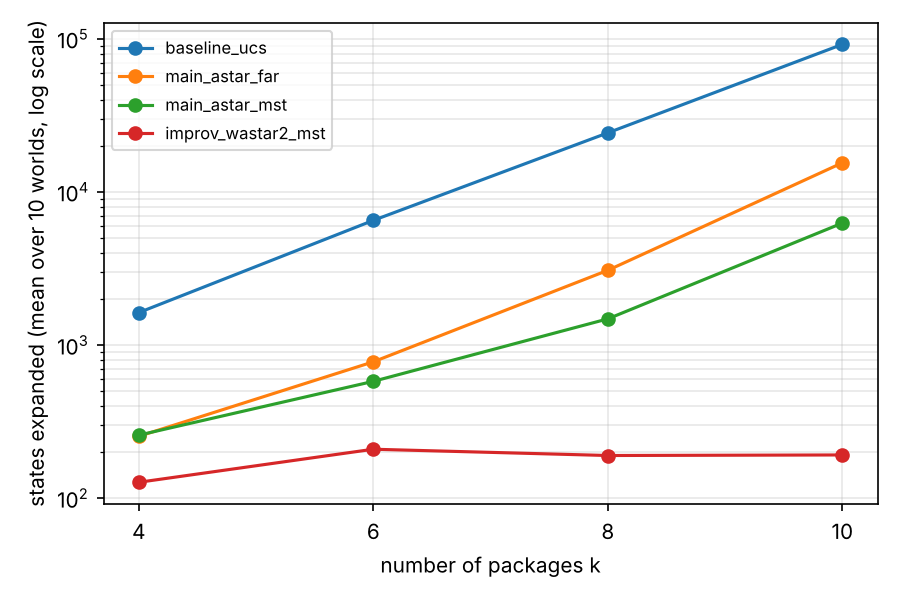

# 1. Problem and formulation

A robot must collect *k* packages on a 12 × 12 grid with about 20% walls, and return to a dock, using the fewest unit-cost steps. A state is (pos, R), where pos is the robot's cell and R is the set of packages still to collect. The initial state is (dock, all packages). A move into a package cell removes that package from R. The goal is that R is empty and the robot is back at the dock. The state space has up to (cells) × 2^k states, which is why search effort grows quickly with *k*.

# 2. Methods

**Baseline.** A\* with h = 0, which is uniform-cost search.

**Main method 1: h_far.** h_far(s) = max over p in R of (|pos − p| + |p − dock|), where |·| is Manhattan distance. Any tour visits p and then ends at the dock, so the bound holds.

**Main method 2: h_mst.** Let T = {dock} ∪ R. Then h_mst(s) = min over x in T of |pos − x| + MST(T), where |·| is Manhattan distance. The MST uses Manhattan weights and is computed with Prim's algorithm. The first target a tour reaches costs at least the minimum attachment distance. The rest of the tour is a connected walk through all of T, so it costs at least MST(T).

**A first attempt that failed.** An earlier version put the robot itself into the MST as a node. It was admissible but **inconsistent**. On a 6 × 6 instance with the dock at (0,0) and packages at (0,1) and (4,3), h = 9 at pos (0,4), and h = 7 after one step to (0,3). A consistent heuristic cannot drop by 2 on a single unit step. The checker found 1,090 consistency violations for this version, and the fixed version above has none.

**Improvement.** Weighted A\* with f = g + 2·h_mst. This is faster but can return routes longer than optimal. We measure the penalty.

# 3. Correctness

1. **Hand-checked case.** In a 1 × 5 corridor with packages at distance 2 and 4 from the dock, the optimum is 8 steps. All exact methods return 8.
2. **Independent oracle.** A brute-force search over all visiting orders, using BFS distances, agrees with A\* on every checked instance (k = 3 in the unit tests, k = 4 and 6 in the experiment).
3. **Exact checker.** On 30 small worlds (6 × 6, k = 2, 3, 4), value iteration gives the true cost-to-go h* for every reachable state. The checker finds **0 admissibility violations and 0 consistency violations** for h_far and the fixed h_mst, and 1,090 consistency violations for the first attempt.
4. **Unit tests.** 13 tests, all passing.

**Proof sketch for h_far consistency.** Let a move go from s to s′ by stepping to a neighbouring cell a. Distances change by at most 1 per step, so there are three cases. If the maximum at s is achieved by a package still remaining at s′, then f_p(pos) ≤ 1 + f_p(a) ≤ 1 + h(s′). If it is achieved by the package a just collected, then h(s) = 1 + d(a, dock). Since d(a, dock) ≤ d(a, p) + d(p, dock) for any remaining p, we get h(s') ≥ d(a, dock), so the inequality holds. If no packages remain, h(s) = d(pos, dock) ≤ 1 + d(a, dock).

**Consistency of the fixed h_mst is not proven here.** The checker supports it on all 30 small instances, but I have not found a complete proof, so I list it as open.

# 4. Experimental setup

All methods run on the same 40 instances: k ∈ {4, 6, 8, 10}, seeds 0–9, on a 12 × 12 grid with 20% walls. Metrics are the number of states expanded (the main effort count), states stored, wall-clock time, and solution cost. The full run takes under a minute. The code is in `src/experiment.py`, and results are in `results/metrics.csv`.

# 5. Results

| k | UCS expanded | h_far expanded | h_mst expanded | Improvement expanded |
|---|---|---|---|---|
| 4 | 1,629 | 253 | 258 | 127 |
| 6 | 6,518 | 777 | 579 | 209 |
| 8 | 24,315 | 3,076 | 1,482 | 190 |
| 10 | 91,978 | 15,495 | 6,259 | 191 |

*Table 1: mean states expanded over 10 worlds per k.*

{width=70%}

**Quality.** Both exact main methods match the UCS optimum on all 40 instances. The improvement matched the optimum on 20 of 40 instances. Its largest penalty was 10 steps. Its worst ratio to optimal was 1.25, and its mean ratio was 1.043. The 2× bound held everywhere.

**Time.** At k = 10, the mean times are 0.52 s (UCS), 0.12 s (h_far), 0.15 s (h_mst), and 0.004 s (improvement). h_mst expands fewer states than h_far, but each state is more expensive to evaluate, so h_far is faster in wall-clock time at every size tested.

**Memory.** At k = 10, the mean peak number of stored states is 92,557 (UCS), 18,835 (h_far), 7,943 (h_mst), and 290 (improvement).

# 6. Analysis

UCS is exact but blind, and its effort grows about 56-fold from k = 4 to k = 10. h_far gives a large reduction (about 6× at k = 10) but looks at one package at a time, so it ignores the cost of visiting several packages in sequence. h_mst takes all remaining packages into account and expands the fewest states among the exact methods from k = 6 upward (at k = 4 it ties with h_far), but its per-state cost is higher. The inadmissible improvement keeps expansions nearly flat at about 200 states. The price is a small average loss of about 4%, with a worst case of 25% above optimal. Whether that trade is acceptable depends on the application.

# 7. Limitations and next steps

- The consistency of the fixed h_mst is tested, not proven.
- The exact checker covers only small 6 × 6 worlds with k ≤ 4. Larger worlds rely on agreement with the oracle and the exact optimal costs.
- Only one grid size and one wall density were tested.
- Only one inadmissible weight (2) was measured. A sweep over several weights would show the trade-off more fully.
- A heatmap of expanded states (the stretch goal) was not produced.
- Possible next steps: a tighter admissible heuristic using precomputed BFS distances, a proof of MST consistency, and a memory-capped test at larger k.

# 8. AI-use statement

An AI assistant (Claude, by Anthropic) helped write the code, tests, experiments, and this report. It proposed the structure and the MST fix, and drafted the text. The numbers were produced by running the repository code, and the tests and the checker were run to confirm the claims. *[Student: review and edit this statement to match what you actually did. You must be able to explain every part at the viva.]*

# References

1. S. Russell and P. Norvig, *Artificial Intelligence: A Modern Approach*, Chapter 3 (uninformed and heuristic search).
2. R. C. Prim (1957), "Shortest connection networks and some generalizations," *Bell System Technical Journal*.
3. I. Pohl (1970), "Heuristic search viewed as path finding in a graph," *Artificial Intelligence*.
